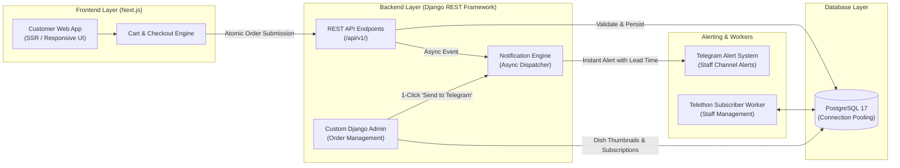

# Oleg G. — Full-Stack Engineering & Client Work Portfolio

<div align="center">

[](https://www.upwork.com/freelancers/~017c69992f8fa4b486)
[](https://github.com/Metarenessans)
[](https://github.com/Metarenessans/freelance/actions)
[](https://metarenessans.github.io/freelance/)

<br/>

**Production-grade Web Applications • Modern React/Next.js Frontends • Resilient Django REST Backends • Asynchronous Telegram Bots • Automated CI/CD Pipelines**

[🚀 Explore Live Portfolio Hub](https://metarenessans.github.io/freelance/) • [💼 Hire Me on Upwork](https://www.upwork.com/freelancers/~017c69992f8fa4b486)

</div>

---

## 🎯 Executive Summary for Upwork Clients

I build robust, end-to-end web products that combine intuitive, responsive user interfaces with resilient, well-modeled backends and automated deployment pipelines. 

Every project in this portfolio is **live, functional, and verifiable hands-on**. You don't need to guess how my code runs — you can click into the web apps, test API responses, explore custom admin systems, and inspect CI/CD automation directly.

---

## ⚡ Interactive Project Directory

| Project | Category | Live Interactive Links | Key Tech Stack | Hands-on Verification |
| :--- | :--- | :--- | :--- | :--- |
| **Catering & Event Commerce Platform** | **Full-Stack Flagship** | 🌐 [Web App Demo](https://catering-portfolio-six.vercel.app)<br/>⚡ [Interactive Swagger API](https://catering-portfolio-api.vercel.app/api/docs/)<br/>⚙️ [Django Admin](https://catering-portfolio-api.vercel.app/admin/) | Next.js SSR, Django REST Framework, PostgreSQL, Telegram Bot, Docker, GitHub Actions | Place cart orders, explore live Swagger UI, query live API endpoints, test admin triggers. |
| **BetBoom Campaign Landing** | **Frontend / Interactive** | 🚀 [Live Demo](https://metarenessans.github.io/freelance/bet-boom/)<br/>📁 [Source Code](bet-boom/) | Vanilla JS (ES6+), CSS3 Keyframe Animations, BEM, GitHub Pages CI | Test interactive gamified tiers, responsive layouts, and cross-browser animations. |
| **DNA Personalized Jewelry** | **Frontend / E-Commerce** | 🚀 [Live Demo](https://metarenessans.github.io/freelance/dna/)<br/>📁 [Source Code](dna/) | Mobile-First Sass / SCSS, Semantic HTML5, GitHub Pages CI | Verify mobile-first responsiveness, product variant selectors, and typography. |

---

## 🌟 Featured Project: Catering & Event Commerce Platform

> **Full-Stack Next.js + Django REST Framework + PostgreSQL + Telegram Notification Engine**

An English-language showcase of a high-touch catering e-commerce application. It features transactional cart ordering, automated lead routing, a custom Django administration interface, and serverless cloud deployment.

### System Architecture



---

### ⚡ Comprehensive REST API Suite (Django REST Framework)

The backend provides a structured, modular API architecture covering the full e-commerce and operational lifecycle:

| Module | Endpoints | Method | Description |
| :--- | :--- | :--- | :--- |
| **Catalog** | `/api/v1/catalog/products/`<br/>`/api/v1/catalog/sections/`<br/>`/api/v1/catalog/categories/` | `GET` | Paginated product catalog with dynamic filtering, image previews, section hierarchies, and dietary options. |
| **Orders** | `/api/v1/orders/` | `POST` | Transactional cart checkout: resolves prices from authoritative catalog models, enforces database constraints, and dispatches Telegram notifications. |
| **Event Inquiries** | `/api/v1/menu-requests/`<br/>`/api/v1/menu-requests/formats/`<br/>`/api/v1/menu-requests/services/` | `GET` / `POST` | Event budget calculator and custom catering inquiries (banquets, weddings, buffets, cocktail bars). |
| **Brand & Content** | `/api/v1/company/`<br/>`/api/v1/faq/`<br/>`/api/v1/blog/articles/` | `GET` | Brand metadata, contact details, working hours, categorized FAQ items, and editorial catering articles. |
| **SEO & Security** | `/api/v1/seo-settings/`<br/>`/api/v1/auth/token/` | `GET` / `POST` | Dynamic OpenGraph metadata, structured JSON-LD schemas, and JWT authentication tokens for staff. |

---

### 🔔 Real-Time Telegram Notification Engine

The backend features an asynchronous notification dispatcher designed so customer transactions never stall waiting on external messaging APIs:

1. **Non-Blocking Asynchronous Delivery:**
   * Order submissions and menu inquiries spawn lightweight background execution threads (`_send_order_notification_bg`, `_send_menu_request_notification_bg`), guaranteeing that the HTTP response returns to the client in milliseconds.
2. **Intelligent Event Lead-Time Calculations:**
   * Computes human-readable event urgency directly into the Telegram alert: e.g., `15 November 2026 (in 3 days)` or `(today)`.
3. **Automated Phone & Social Resolution:**
   * Cleans and formats phone numbers (`clean_phone_number`) and resolves associated Telegram user links for immediate staff outreach.
4. **Standalone Subscriber Worker (`telegram-bot/main.py`):**
   * Built on `telethon`/polling, allowing managers and operations staff to subscribe/unsubscribe to real-time order streams via bot commands.

---

### 🛠️ Custom Django Administration Suite

Rather than relying on generic auto-generated tables, the administrative dashboard was engineered to optimize operational workflows:

* **1-Click Telegram Re-dispatch Action:** An interactive `Send to Telegram` button in the order changeform view triggers on-demand dispatch with feedback banners.
* **Visual Dish Thumbnails (`OrderItemInline`):** Integrated image previews display thumbnail photos of each ordered dish alongside quantities and prices.
* **Subscriber Management (`TelegramSubscriberAdmin` & `EmailSubscriberAdmin`):** Interface to monitor active notification recipients with integrated SMTP diagnostic checks (`check_smtp_view`).
* **Authoritative Server Pricing:** Front-end clients cannot modify item prices; the backend independently calculates all sums, applies item options, and commits orders atomically to PostgreSQL.

---

### 🚀 CI/CD & Cloud Infrastructure

* **GitHub Actions Workflows:** Automated linting, code translation verification, and unit test discovery on every push.
* **Dual Vercel Deployments:** Independent build pipelines for Next.js SSR frontend and Django serverless WSGI API.
* **Database Isolation:** Connected to persistent PostgreSQL with SSL encryption and pooling, keeping portfolio submissions separated from production data.
* **Docker Compose:** Multi-service local environment replicating production configuration in one command.

---

## 🧪 How to Verify Everything Hands-On (60 Seconds)

You can verify the entire workflow right now:

1. **Step 1 (Frontend):** Visit the [Catering Live Web App](https://catering-portfolio-six.vercel.app). Browse the menu, add canapés to your cart, and submit a test order with fictional contact info.
2. **Step 2 (Swagger & API):** Explore the live [Interactive Swagger UI](https://catering-portfolio-api.vercel.app/api/docs/) covering all 32 endpoints, or test raw endpoints like [API Products](https://catering-portfolio-api.vercel.app/api/v1/catalog/products/).
3. **Step 3 (Admin Panel):** Inspect the [Django Admin Interface](https://catering-portfolio-api.vercel.app/admin/) to review how staff manage orders and notification triggers.
4. **Step 4 (Client Landings):** Check out the [BetBoom Promo Demo](https://metarenessans.github.io/freelance/bet-boom/) and [DNA Jewelry Demo](https://metarenessans.github.io/freelance/dna/) to test animation performance and mobile adaptability.

---

## 💻 Full-Stack Technical Capabilities

| Domain | Core Technologies & Methodologies |
| :--- | :--- |
| **Frontend** | **Next.js SSR, React, TypeScript, Modern JavaScript (ES6+), Tailwind CSS, Sass/SCSS, Responsive & Accessible UI** |
| **Backend** | **Python 3.11+, Django, Django REST Framework (DRF), PostgreSQL, Redis, RESTful API Design, Atomic Transactions** |
| **Integrations** | **Telegram Bot API, Telethon, Async Webhooks, SMTP Email Notifications, Third-party REST Integrations** |
| **DevOps & CI/CD** | **GitHub Actions, GitLab CI, Docker, Docker Compose, Vercel, PostgreSQL, Linux/Nginx, Automated Testing** |
| **Code Quality** | **Sanitized Secrets, Comprehensive Unittest Suites, Clean Architecture, Clear Technical Documentation** |

---

## 📁 Repository Structure

```text
.
├── .github/
│   └── workflows/
│       └── pages.yml        # CI/CD: Automated testing & GitHub Pages deployment
├── bet-boom/                # BetBoom sports community campaign
│   ├── src/                 # Original source HTML, JS, styles
│   └── public/              # Shipped demo bundle
├── dna/                     # DNA personalized jewelry e-commerce showcase
├── tests/                   # Automated regression & catalog tests
├── index.html               # Redesigned interactive portfolio hub
└── README.md                # Client-facing documentation & project specifications
```

---

## 🛠️ Local Development & Automated Checks

To run the static portfolio and test suites locally:

```sh
# 1. Run local development server
python -m http.server 8000

# Visit in your browser:
# Gallery: http://localhost:8000/
# BetBoom: http://localhost:8000/bet-boom/public/
# DNA:     http://localhost:8000/dna/
```

### Running Automated Test Suites

```sh
# Run all test suites
python -m unittest discover -s tests -v
python -m unittest discover -s bet-boom/tests -v
python -m unittest discover -s dna/tests -v
```

---

## 🤝 Let's Work Together

I am available for contract and full-time engagements on **Upwork**:
- **Full-Stack Web Development** (Next.js + Django)
- **Custom Admin Panels & Dashboards**
- **Telegram Bot & Workflow Automation**
- **DevOps, Docker & CI/CD Pipelines**

👉 **[Hire Me on Upwork](https://www.upwork.com/freelancers/~017c69992f8fa4b486)** • Fast responses, clean delivery, and production-ready code.
